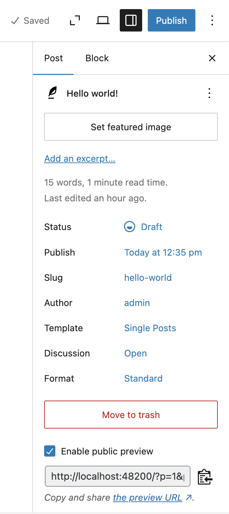

# Public Post Preview

WordPress plugin to share a link to anonymous users to preview a draft of a post (or any other public post type) before it is published.

Have you ever been writing a post with the help of someone who does not have access to your blog and needed to give them the ability to preview it before publishing? This plugin takes care of that by creating preview links that you can share. Each link expires after a while, and you can revoke it at any time.

[<kbd> <br> Preview stable version in WordPress Playground <br> </kbd>](https://playground.wordpress.net/?blueprint-url=https://raw.githubusercontent.com/ocean90/public-post-preview/refs/heads/master/.wordpress-org/blueprints/blueprint.json)

[<kbd> <br> Preview development version in WordPress Playground <br> </kbd>](https://playground.wordpress.net/?blueprint-url=https://raw.githubusercontent.com/ocean90/public-post-preview/refs/heads/master/.wordpress-org/blueprints/blueprint-development.json)

<p align="center">

</p>

*This plugin was previously maintained by [Matt Martz](http://profiles.wordpress.org/sivel/) and was an idea of [Jonathan Dingman](http://profiles.wordpress.org/jdingman/).*

## Installation

For an installation through WordPress:

1. Go to the 'Add New' plugins screen in your WordPress admin area
1. Search for 'Public Post Preview'
1. Click 'Install Now' and activate the plugin


For a manual installation via FTP:

1. Upload the `public-post-preview` directory to the `/wp-content/plugins/` directory
1. Activate the plugin through the 'Plugins' screen in your WordPress admin area


To upload the plugin through WordPress, instead of FTP:

1. Upload the downloaded zip file on the 'Add New' plugins screen (see the 'Upload' tab) in your WordPress admin area and activate.

## Usage
* Save the post as a draft. Preview links are available for any post that is saved but not yet published.
* In the block editor, click "Create link" next to "Preview link" in the post summary. In the classic editor, click "Create link" next to "Public preview" in the "Publish" box.
* Copy the new link right away and share it. The full link is shown only once, since the plugin stores only a hash of it.
* Create more links if you like, for example one per reviewer. You can give each link a label, extend it, or revoke it.
* A link stops working when it expires, when you revoke it, or when the post is published.

## Frequently Asked Questions

**I can't find the option for preview links. Where is it?**

Preview links are only available once a post is saved, for example as a draft, and until it is published. They are available for all post types that are publicly viewable.

**I lost a preview link. Can I see it again?**

No. The plugin stores only a hash of each link, so nobody can read the link from the database. Create a new link, and revoke the old one if you no longer need it.

**My preview links from before version 4.0 no longer work. Why?**

Version 4.0 replaced the old links, which were based on a nonce, with links that can be revoked one by one. Old links show the message "This link format is no longer valid". Create a new link for each draft you still want to share.

On the plus side, new links last exactly as long as you set. A nonce counts time in steps of half its lifetime, so an old link set to 48 hours could stop working after just 24 hours.

**A preview link says "This link expired on …". What can I do?**

By default a new link expires after 48 hours. Extend the link in the editor, up to one year from now, or create a new one.

**Can I change how long new links last?**

Yes. Go to Settings > Reading > Public Post Preview and change the Expiration Time setting. You can also use the filter `ppp_default_link_lifetime`. Example for 5 days:

```php
add_filter( 'ppp_default_link_lifetime', 'my_preview_link_lifetime' );
function my_preview_link_lifetime() {
	return 5 * DAY_IN_SECONDS;
}
```

The setting is hidden if the filter is used. No link can last longer than one year, which you can lower with the filter `ppp_link_max_lifetime`. The old filter `ppp_nonce_life` still works but is deprecated.

**How many preview links can a post have?**

Up to 20 active links. Expired and revoked links don't count. You can change the limit with the filter `ppp_max_links_per_post`.

**Can I see whether someone opened a link?**

Yes. The editor shows when each link was last opened. The plugin doesn't store IP addresses, and visits by users who can edit the post don't count.

**Can I manage preview links from code or with an AI agent?**

Yes. The REST API offers the routes `/public-post-preview/v1/posts/<id>/links` and `/public-post-preview/v1/posts/<id>/links/<link_id>`. The same operations are available as abilities of the Abilities API in the category `public-post-preview`, which the MCP Adapter can offer to AI agents. Both apply the same permission checks as the editor.

**The public preview shows an outdated version of the post. Why?**

Preview pages are sent with headers that tell browsers, proxies and CDNs not to cache them. Some caching setups ignore these headers, for example a CDN rule that caches every page, such as "Cache Everything" on Cloudflare, or a page cache that also caches URLs with query strings. Exclude URLs containing the `_ppp` parameter from your cache to fix this.
